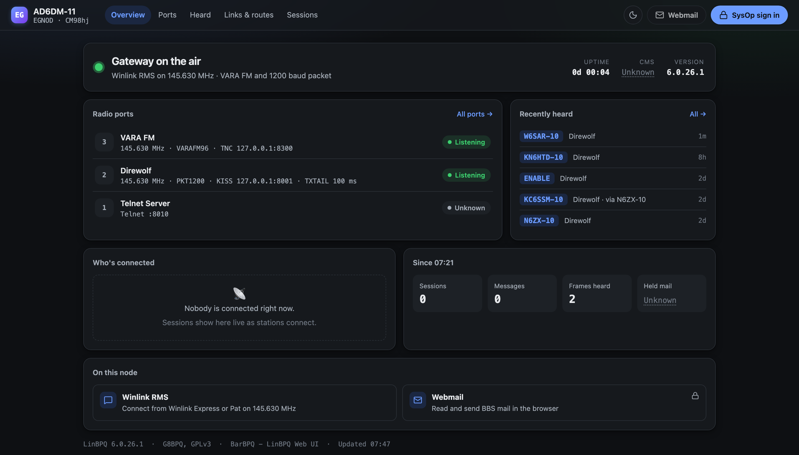
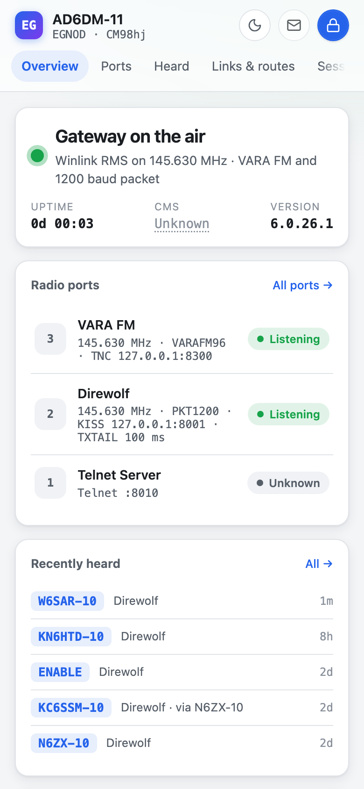
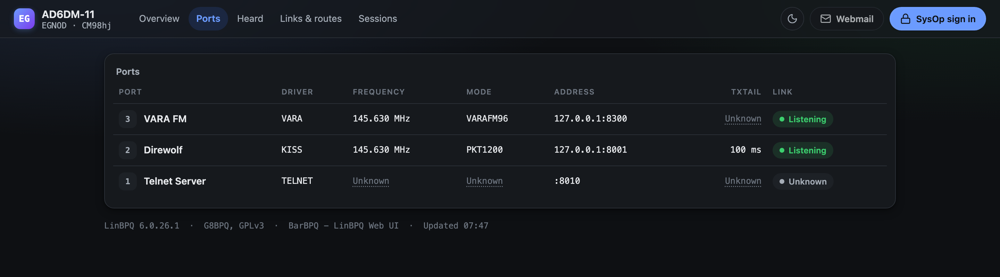
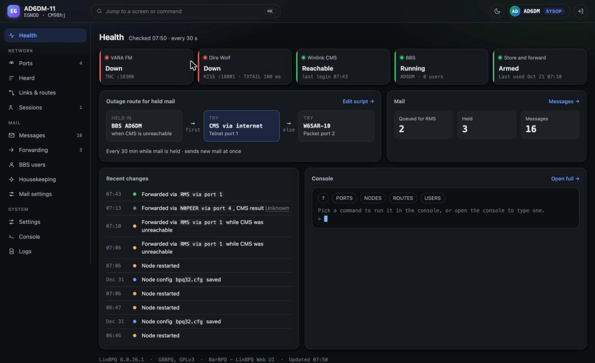
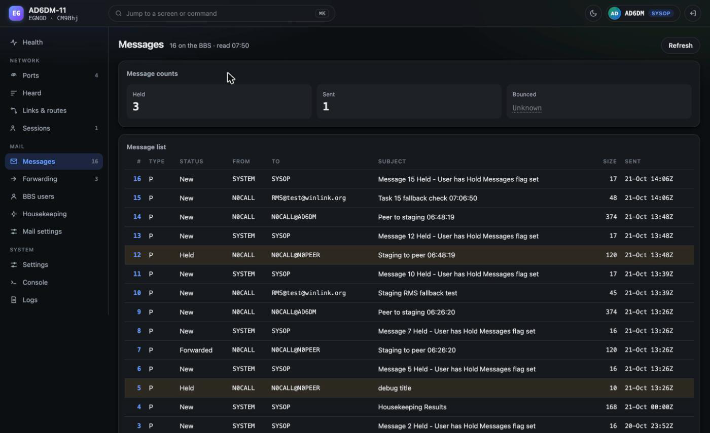
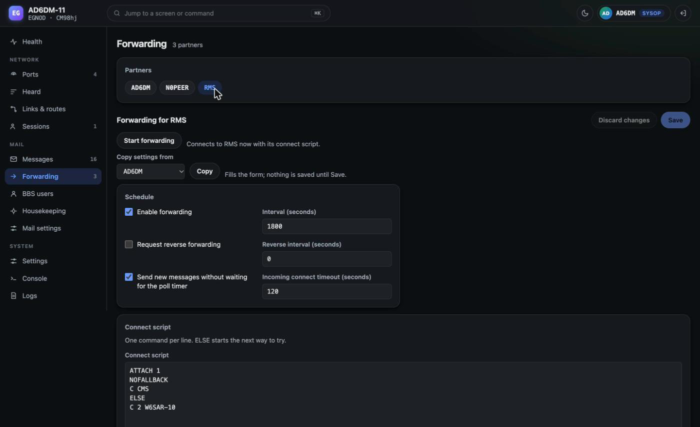
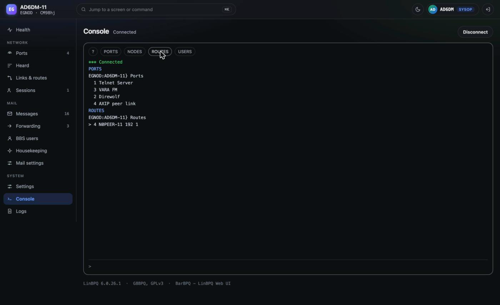

# BarBPQ - LinBPQ Web UI

BarBPQ is a fork of [LinBPQ](https://github.com/g8bpq/linbpq), John Wiseman G8BPQ's packet radio node, BBS and Winlink gateway, with a new web front end for the node's built-in web server. It is based on upstream version 6.0.26.1.

It adds two things:

- A static web UI (in `overlay/`) that the node serves from its `HTML/` directory. Its public pages show the station, ports, links and routes, sessions and the heard list. For the SysOp it covers sign-in, node settings, mail settings, BBS users, forwarding, messages, a console and the log viewer.
- A small read-only JSON API under `/api/ui/` (in `uiapi.c`) that the UI reads: station summary, links, CMS state, counters and the heard list, plus recent events for a signed-in sysop.

Upstream's own pages under `/Node/` and `/Mail/` stay in place and keep working.

<p align="center">
  
  <br><em>Overview on a live Winlink RMS gateway</em>
</p>

<p align="center">
  
  <br><em>Phone view, light theme</em>
</p>

BarBPQ is Linux only. Its release bundle holds a 64-bit x86-64 Linux build of `linbpq`. Upstream's Windows and macOS build files are left untouched and are not built or tested.

## Screens

Each port shows its driver, frequency, mode, address and whether its modem is linked. VARA reports its TNC connection and KISS over TCP its socket. A serial or USB KISS TNC reports whether the node holds its device open, which says nothing about whether the TNC answers. AXIP reports whether its socket is bound to the configured port and how many mapped peers were heard in the last hour. A KISS port stopped from the node reads Down. KISS over UDP and other drivers read Unknown, never a guess. AXIP ports are internet links, so the Overview lists them apart from the radio ports, and they don't count when the banner decides whether every radio is down.

<p align="center">
  
</p>

For the SysOp, Health gathers the radios, the CMS link, the BBS and the store-and-forward path into one page, with the outage route a held message takes when the CMS is unreachable and the node's recent changes. The shots below come from the test node described in [docs/staging-preview.md](docs/staging-preview.md), which runs with test callsigns and no radios attached.

<p align="center">
  
</p>

Messages lists everything on the BBS with its status, and a message opens for release, hold or kill. Forwarding edits each partner's schedule and connect script, ELSE fallbacks included, and starts a run on demand.

<p align="center">
  
</p>

<p align="center">
  
</p>

The console is the node's own command line in the browser, one command at a time with its echo, plus one-click buttons for the common ones.

<p align="center">
  
</p>

## Building

Docker builds the binary, so any host with Docker can build it:

```bash
docker/build.sh test     # C tests
docker/build.sh binary   # writes out/linbpq
```

Building the web UI needs Node.js:

```bash
cd overlay && npm ci && npm test && npm run build   # writes overlay/dist/
```

`scripts/release.sh` runs all of the tests, builds both, and assembles a bundle in `out/release/barbpq-<version>-<n>/` holding `linbpq`, `HTML/`, `rollback.sh`, `VERSION` and `SHA256SUMS`. It never contacts a node.

To try the UI without touching a node on the air, `docker/staging.sh up --peer` runs the build in Docker beside a second node and a stand-in CMS; [docs/staging-preview.md](docs/staging-preview.md) covers it.

## Installing

[INSTALL.md](INSTALL.md) has the full procedure, each step with the check that has to pass before the next. In outline: copy the bundle to the node and check its sums, keep a copy of the current binary, record how the node is running, copy the UI into the node's `HTML/` directory, snapshot the BBS data files with the node stopped, move the new binary into place, and start linbpq again in its tmux session with `./rollback.sh --start`. The node is off the air only between the stop and the start, a few seconds on a typical machine.

Once linbpq is back, the new home page answers at the node's web port (for example `http://node:8088/`), and the old pages under `/Node/` and `/Mail/` still answer.

## Rolling back

From the bundle directory on the node, `./rollback.sh --dry-run` shows what it would do and `./rollback.sh` does it: it removes the UI files the install added, puts the saved binary back, and starts linbpq again. Running it twice is safe, and it always tries to leave linbpq running, even when a step fails. It restores the binary only; [INSTALL.md](INSTALL.md) 4.2 puts back the BBS data snapshot if the old build cannot read what the new one wrote. A browser that loaded the new UI may need a hard reload (Ctrl+Shift+R) to show the old menu.

## Merging a new LinBPQ release

BarBPQ edits G8BPQ's C files only by one-line calls marked `// uiapi hook`, so a new upstream release usually merges cleanly. With G8BPQ's repository as the `upstream` remote:

```bash
git remote add upstream https://github.com/g8bpq/linbpq   # once
scripts/sync-upstream.sh --dry-run   # the new releases, and which edited upstream files they touch
scripts/sync-upstream.sh             # merge into ui, check the hook lines, run the test suites
```

The script works on the `ui` branch, refuses a dirty tree, and never pushes. On a conflict it names the files and stops with the merge in progress. Fix them, keeping every `// uiapi hook` line, then `git add`, `git commit` and `scripts/sync-upstream.sh --continue`, which checks the hook lines and runs the tests. A hook line that is gone or changed after the merge fails the run and is printed. `scripts/test_sync_upstream.sh` tests the script against throwaway repositories.

## License

G8BPQ's code is under the GNU General Public License version 3 or later. Bundled third-party code keeps its own notices. BarBPQ's web UI and `uiapi.c`/`uiapi.h` are Copyright (C) 2026 Dennis Mojado, also under GPL-3.0-or-later. See `LICENSE`.
